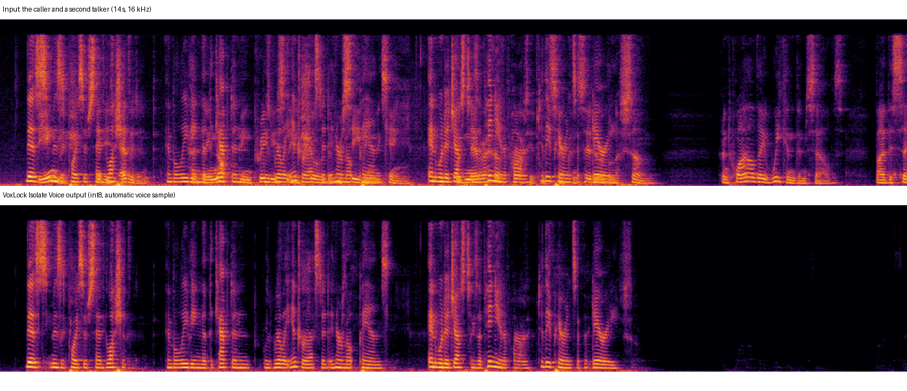

# VoxLock Voice Isolation for ComfyUI

Keep one voice and remove the other voices in a recording, inside ComfyUI, with the official **VoxLock** models
([arbazsiddiqui/voxlock](https://github.com/arbazsiddiqui/voxlock), [model card](https://huggingface.co/arbazsiddiqui/voxlock)).
VoxLock is a small target-speaker isolation model: it takes a few seconds of the voice to keep (or finds them itself) and removes
other people talking over it. It runs on the CPU through ONNX Runtime, about 12 times faster than real
time here. The nodes call the official `voxlock` package and never download anything.

> **Unofficial.** This node pack is an independent integration. It is not affiliated with or endorsed by the VoxLock author or by
> Comfy Org.
>
> 日本語の概要は [README.ja.md](README.ja.md) にあります。



*A demo mixture from the VoxLock repository: two LibriSpeech test-clean speakers (CC BY 4.0) in a simulated room, the second one
talking over the first and alone at the end. Bottom: this pack's output (int8, automatic voice sample), which is bit for bit the
official package's output for the same file.*

## What it does

| Node | Purpose |
| --- | --- |
| **VoxLock Loader** | Picks the model precision (int8, int8-full, fp16, fp32) and the CPU thread count |
| **VoxLock Isolate Voice** | `AUDIO` in → `AUDIO` with only the kept voice, plus a JSON report. Optional `voice_sample` input: a few seconds of the voice to keep |

Connect ComfyUI's **Load Audio** in front and **Save Audio** / **Preview Audio** behind; the shipped workflows do that.

- Without a voice sample, the node keeps the voice of the loudest 3 s in the first 15 s of the input, as the official command line
  does. Give a sample when another voice is louder at the start.
- The model works on 16 kHz mono speech. Inputs of any rate and channel count are mixed to mono and resampled exactly as the
  official `voxlock.load_audio` does. The output is 16 kHz (`output_sample_rate` = `16000`) or resampled back to the input's rate
  (`input`; the content stays 16 kHz band-limited).
- The output is in phase with the input and at about its level, so it can be mixed back with other tracks.
- Batches: every item is isolated on its own; one voice sample for all items, or one per item.

## How far it was checked

Windows 11, ComfyUI v0.38.0, CPU (Intel Core Ultra 9 285K); details and raw numbers in [docs/VERIFICATION.md](docs/VERIFICATION.md):

- **Bit-identical to the official package.** On real speech (three demo mixtures from the VoxLock repository, all four
  precisions, a 48 kHz stereo copy, a given voice sample) the pack's output equals the official `voxlock` 1.1.1 output for the
  same file, byte for byte (SHA-256 of the float samples), 8 of 8. The official side ran in a separate environment with only
  `pip install voxlock==1.1.1`.
- **Real ComfyUI queue:** Load Audio → VoxLock → Save Audio (FLAC) gives the official output to within half a 16-bit step (the
  rounding of the 16-bit FLAC) in 5 of 5 jobs, including the voice-sample workflow and output at 48 kHz.
- **Clean install:** fresh ComfyUI v0.38.0, fresh Python 3.12 environment, `git clone` of this repository, `pip install -r
  requirements.txt` (adds only new packages), the models downloaded with `tools/download_model.py` (SHA-256 verified), and the
  real-queue check against the installed pack.
- **CI** (GitHub Actions; Ubuntu and Windows, Python 3.12 / torch 2.14.1 and Python 3.10 / torch 2.8.0): the real models on
  synthetic two-voice audio, the pack compared with the official steps for every precision, ComfyUI's own validation of the
  workflows, and a real ComfyUI queue.

**Not checked:** Linux and macOS outside CI, other ComfyUI versions with the real model (the CPU tests and the real-queue check also run against ComfyUI v0.41.0 in CI), music or singing (VoxLock is trained for speech), and the
isolation quality itself (the pack reproduces the official outputs; it does not re-evaluate the model).

## Install

1. ComfyUI with the V3 node API (**v0.38.0** was used) and Python 3.10+. No GPU is needed.
2. Clone this repository into `ComfyUI/custom_nodes/` and install its requirements into ComfyUI's Python:

   ```
   git clone https://github.com/hiroki-abe-58/ComfyUI-VoxLock custom_nodes/ComfyUI-VoxLock
   python -m pip install -r custom_nodes/ComfyUI-VoxLock/requirements.txt
   ```

   This installs `voxlock==1.1.1`, which brings `onnxruntime`, `soundfile` and `soxr`.

3. Download the models (about 275 MB for all four precisions, or pick some with `--precisions int8`). The script pins the revision
   the voxlock 1.1.1 package itself uses and verifies every file's SHA-256:

   ```
   python custom_nodes/ComfyUI-VoxLock/tools/download_model.py --models-dir models/voxlock
   ```

   Result: `models/voxlock/onnx/` with `enroll.onnx`, `enroll_fp16.onnx`, `chunk.onnx`, `chunk_fp16.onnx`, `chunk_int8.onnx`,
   `chunk_int8_full.onnx` (and `config.yaml`, `LICENSE`). Another location works through `extra_model_paths.yaml` with the key
   `voxlock`.

4. Restart ComfyUI and open `workflows/gui/isolate_voice.json` or `workflows/gui/isolate_with_sample.json`; choose your own
   recording in Load Audio (the workflows name `voice_mix.wav` and `voice_sample.wav`).

## Precisions and speed

10 minutes of 16 kHz speech, CPU (24 threads, ONNX Runtime 1.31.0), model loaded:

| Precision | Files | Time | Speed |
| --- | --- | --- | --- |
| int8 (default) | 79 MB | 49.1 s | 12x real time |
| int8-full | 70 MB | 45.9 s | 13x real time |
| fp16 | 51 MB | 73.9 s | 8x real time |
| fp32 (the model the author benchmarks) | 100 MB | 72.6 s | 8x real time |

Memory: about 0.1 GB on top of ComfyUI for a 10-minute input. The author reports 5.11 % word error rate for int8 and 4.95 % for
fp32 on the Krisp benchmark (not measured here).

`threads` = 0 (the default, as in the official package) lets ONNX Runtime choose. The thread count changes the int8 output slightly:
on the 14 s demo clip, 1, 4 or 8 threads instead of the automatic choice changed samples by up to 0.0025 (about -52 dBFS); fp32
changed by at most 2.4e-7 with 1 thread and not at all with 4 or 8. The same settings on the same machine give the same output every
time; another machine with another core count can give slightly different int8 output with `threads` = 0.

## Notes and limits

- Speech only, one voice kept. If the loudest voice in the first 15 s is not the one you want, give a `voice_sample`.
- The output is 16 kHz content; `output_sample_rate` = `input` resamples it, it does not restore the high frequencies.
- Interrupt stops between two model runs (one per 0.8 s of audio).
- The upstream repository's demo clips of the isolated voice have the opposite polarity to the package's 1.1.1 output (they are
  otherwise the same signal); the package's output is the one in phase with the input.

## Licenses

- This node pack's code: **MIT** ([LICENSE](LICENSE)).
- `voxlock` package (installed from PyPI) and the VoxLock model files (downloaded only by `tools/download_model.py`):
  **Apache-2.0**, by Arbaz Siddiqui ([NOTICE](NOTICE)).

## Development

```
python -m pip install pytest ruff
python tools/download_model.py --models-dir <dir>/voxlock
VOXLOCK_MODELS_DIR=<dir>/voxlock VOXLOCK_COMFYUI_DIR=<ComfyUI checkout> python -m pytest tests
python scripts/ci_queue_check.py --comfyui <ComfyUI checkout> --models-dir <dir>/voxlock   # real queue on the CPU
```

`scripts/run_jobs.py` runs the pack's runtime on files and records hashes comparable with the official package.
